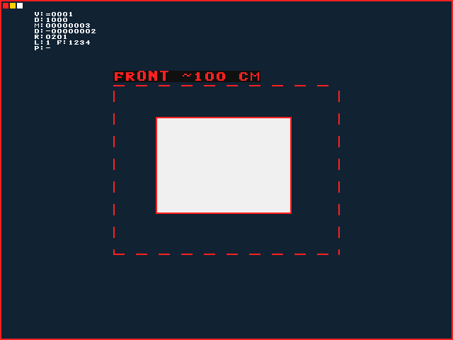

# 中央前方描边方案：离线制作完成

已完成用户授权的“中央前方区域描边＋前方障碍距离约 ×× cm＋风险颜色提示”，并完成开源先行研究、一轮可复现审查与修复、流水优化、独立像素复验、完整整机布线与同源运行包制作。硬件尚未连接，实板验收保持PENDING；本次交付为LAB_ONLY无电机台架包。

## 显示效果与使用范围

中央320×240区域描边，保留摄像头原始画面；标注 `FRONT ~100 CM` 表示前方障碍距离约100厘米。绿/黄/红表示帧关联的历史风险，失效为紫色 `FRONT ~--- CM`。原有车辆状态、实时安全外框和实际STM32反馈仍存在。上图白色矩形、距离、风险均为仿真刺激，PNG来自生产包装层真实RTL像素输出，原始文件与哈希见 `preview_provenance.json`。

超声波距离代表前方测距区域，不绑定每条视觉轮廓。Sobel描边也会包含纹理与阴影，没有逐对象识别或深度。因果窗口使边缘向右/下各偏1像素；厘米显示为floor(mm/10)，不声明厘米级实测精度。详细契约及实板检查项在随包 `FRONT_OVERLAY.md`。

## 开源、审查和优化

先阅读 erendn/sobel-pipeline-fpga（MIT，固定提交 `c765b9d058ce489f9b262e9c5e83a99599a91e4a`）和Microchip官方Sobel教程，再独立实现本项目AXIS、行缓存调度、ROI和同帧标注。参考快照、许可和SHA256保留在 `references/` 与 `reference_hashes.json`，没有复制来源链不明确的上游算子代码。

审查复现了“前级接受时新鲜、下游SOF因停顿跨越200ms而过期”导致同帧显示有效性不一致的问题；已统一接受SOF锁存位，修复前/后日志及说明见 `REVIEW.md`。优化将六个差分与加权求和分拍，模块OOC setup余量1.791→3.323ns，关键数据路径8.234→6.670ns，LUT347→341、FF316→416，保持1像素/拍；增加1拍流水延迟，无整行或整帧原视频缓存。

## 验证证据

完整流水线六个阶段全部PASS。203项Python测试、2组既有C测试、14个生产C故障场景、15组RTL测试、5组独立像素比较、10个模块综合门禁均通过。

像素比较累计3,487,744个像素零差异，其中新增描边六帧1,843,200像素，生产包装层四帧1,228,800像素；覆盖停顿、复位、连续帧、重复身份、过期重放、不同历史状态和SOF后实时状态改变。另独立算术覆盖全部4096种毫米输入的厘米换算。完整门禁日志保存在 `preintegration/evidence/complete_v09_front_20261001_r1/`。

整机全部布线，未布线/部分布线网络均0；WNS +0.278ns、WHS +0.028ns，TNS/THS为0。DRC只有1项REQP-181 Advisory，无Warning/Critical Warning/Error。资源为LUT8688、FF12734、BRAM Tile4、DSP9，相对前一完整性能版本新增约309 LUT、421 FF和1 BRAM Tile，DSP不增加。

独立终检 `verify_final.py` 已核对284个构建输入、13个本次功能源快照、6份阶段日志、20份运行模块、bit/HWH绑定、34个ZIP文件、时序/DRC和布线结果；结果为 `final_validation.json`，passed=true。

## 交付

唯一当前构建：`v09_front_20261001_r1`，契约ID仍为 `0xC4251009`（寄存器布局与消费者接口未变），最新指针 `preintegration/latest_candidate.json` 已更新。

- 文件夹：`pynq_fpga/lab/task7_8_lab_only_v09_front_20261001_r1/`
- ZIP：`pynq_fpga/lab/task7_8_lab_only_v09_front_20261001_r1.zip`
- ZIP SHA256：`daed8eb693dcc68251c596a6aa2d1867b545f4b209b9fbafa545418eb73c1d11`
- 分类：`LAB_ONLY_NO_MOTOR_NON_RELEASE`；硬件验收：`PENDING`

当前640×480@30fps为系统目标，最低25fps为实板验收目标，均未因本次RTL结果升级为实测。后续实板应核实摄像头与超声波安装方向、不同材质/角度的距离、实际纹理的描边阈值、失效提示、持续帧率与端到端延迟。离线开发任务完成，不代表实物联合验收完成，也不改变现有电机与发布门禁。
