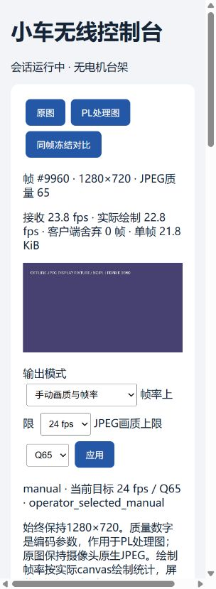

# 无线完整工程五轮审核报告

日期：2026-10-04。硬件保持PYNQ-Z2、STM32、传感器、PCB/底盘；GL-SFT1200局域网连接。无实板连接，本报告区分代码/离线证据和待测的实机性能，交付仍为LAB_ONLY。

## 版本与源码范围

起点为latest_candidate记录的v09_front_20261001_r1 / 0xC4251009。最终完成版本为 **v09_wireless720_five_20261004_r3**，2026-10-04 04:22完成。新无线源码同时保留独立HDMI配置；bit/HWH、20项基础runtime及13项无线/native/UI文件均与同版源码哈希绑定。latest_candidate已更新到r3，r1/r2失败目录不用于部署。

- [完整LAB_ONLY工程包](../../lab/task7_8_lab_only_v09_wireless720_five_20261004_r3.zip)
- [完整构建记录](../../preintegration/evidence/complete_v09_wireless720_five_20261004_r3/pipeline.json)：native、来源冻结、全套回归、回归后来源核验、整机布局布线、打包、最终来源核验七阶段均PASS。
- [最终交付复核](round5_evidence/delivery_verification.json)：压缩包CRC、ZIP SHA256、包内bit/HWH/20+13代码逐字节一致、来源清单匹配、720p双DMA HWH及只读部署检查均PASS；未加载Overlay或打开UART。
- [本版部署说明](../../lab/task7_8_lab_only_v09_wireless720_five_20261004_r3/WIRELESS_SETUP.md)

ZIP SHA256：`f5d63e845d5079e1f8cd5f168f79b0911eb7af63983fd992d8e7ee0457adbc34`。

全量读取清单见[source_inventory.json](source_inventory.json)：310个来源绑定文件，约9.7万行，含25份RTL/适配代码、58份测试、76份PS/构建/合同文本、72份STM32/PC文本和79份固定第三方IP文本；生成文件和历史备份不作权威实现。脚本读完整文本并逐个核验SHA256，Python全部只编译语法不导入硬件；关键时序、所有权、命令和传感器语义由各轮跨层反例检查。

## 五轮结果与改动

各轮先制定计划，再检查/修改/复验：[总计划](PLAN.md)、[第一轮](round1.md)、[第二轮](round2.md)、[第三轮](round3.md)、[第四轮](round4.md)、[第五轮](round5.md)。每轮C/软件日志在对应roundN_evidence中；最后还有完整RTL、像素参考与布局布线流程。

| 轮次 | 主要问题 | 修改和验证 |
|---|---|---|
| 1 稳定性 | 摄像头异常结束整个联合会话 | 记录故障、撤销意图、有限退避重开；坏JPEG丢弃。摄像头恢复后不自动接管，本地采样继续 |
| 2 流畅显示 | 无限客户端排队风险、24fps简单计时退成15fps、旧拥塞重复计数 | 一个解码任务+一个最新JPEG，复用canvas；累计截止时间；新拥塞降档/稳定5秒恢复，手动/自动/固定三模式 |
| 3 控制 | 停车原因不易定位，缺少持续正常运行检查 | 增加明确原因和命令/风险同批状态；生产C零意图和持续驾驶各模拟60秒；WS1200新意图无自动撤销 |
| 4 传感器 | ZERO软件/RTL边界不一致，速度截断低估制动距离 | ZERO>=66；正Q16.16速度向上取整；独立扫查3738旧反例修复，23827项通过 |
| 5 整机与长期 | 新bit清标定后无无线启动加载入口，长期统计积累，JS未纳入全源绑定 | 增加启动标定与配置依赖检查；统计上限8192、累计最坏值/总数保留；CPU/RSS/内存采样；最终全套构建/打包 |

固定验收模式维持720p30/Q75/4:2:0，不补帧、不静默降档。自动模式是运行体验选择，低于30fps时如实显示，不能将其算作原目标通过。

## 实际显示与控制

上位机独立显示接收fps、canvas实际绘制fps、舍弃帧数、单帧KiB、当前目标fps/编码质量和调节原因。手动帧率30/25/24/20/15/10/5；质量95/85/75/65/55/45/35；始终720p。原图JPEG直接转发，画质来自相机，质量设置作用于处理图。

本地真实浏览器用明确标为NO PL的桌面JPEG测试：固定24/Q65多个完整分钟发送23.98—24.02fps，接收/绘制按实时窗口约24fps；同帧冻结和恢复、零输出接管/STOP成功，2292次ACK RTT记录且无拒绝。日志见[浏览器记录](round2_evidence/browser_status.json)，界面见下图。这里只验证接收程序，不能证明5GHz、C270采集或板上编码。

启动/保护锁存是预期状态；用户未操作时不会自行解除。保护条件包括意图250ms到期、旧包/时钟不可靠、PL数据无效或过期、反馈缺失、STM32锁存、视频故障。每个原因可读，重连不恢复旧运动。正常持续测试不能保证实车“绝无bug”，电气和实际制动仍待验证。

## 性能预算：可算部分

| 项目 | 720p30预算 | 意义 |
|---|---:|---|
| 唯一像素 | 27.648M像素/s | II=1、100MHz的像素槽占27.65%，理论约108.5帧/s槽容量；不是整机帧率 |
| BGR0单帧 | 3,686,400B，行跨度5120B | 每帧约3.52MiB |
| 六个DMA缓冲 | 22,118,400B，约21.09MiB | 512MiB容量约4.12%，另有Linux、UVC、JPEG和统计开销 |
| VDMA读+写 | 221.184MB/s | HP0单个64bit/100MHz理论800MB/s的27.65%；有效效率需测 |
| 解码写+DMA读/写+编码读 | 至少442.368MB/s | DDR理论峰值2.1GB/s约21.06%，未计JPEG/缓存/网络/其他主设备；不能据此认定余量79% |
| 300KiB JPEG/30fps | 73.728Mbps | 2倍余量要求147.456Mbps，150Mbps适用此大小附近 |
| 实测桌面随机纹理553,517B/Q75 | 132.844Mbps | 2倍余量要求265.688Mbps；复杂场景不能沿用150Mbps“已足够”的结论 |

桌面native基准37.71fps解码+编码、编码独测75.80fps，SIMD关闭，全部只是AMD64正确性/负载参考。A9+NEON实际速度未知。由于两核还负责Linux、采集、MMIO、UART、网络与JPEG，本轮不能给出可信的CPU剩余百分比。现已提供两核进程/系统CPU、VmRSS/VmHWM和MemAvailable采样，实机连续30分钟后再分配预算；CMA/DMA映射的计入方式需对照板上统计，不能只看RSS。

最终720p无线整机布局布线已通过：100MHz建立WNS=+0.111ns、保持WHS=+0.014ns，DRC无Warning/Critical Warning/Error级违例；工具的Advisory提示保留，没有豁免检查。原始报告见[时序](round5_evidence/timing_final.rpt)、[利用率](round5_evidence/utilization_final.rpt)、[DRC](round5_evidence/drc_final.rpt)。

| PL资源 | 实际使用/总量 | 使用比例 | 尚余容量 |
|---|---:|---:|---:|
| LUT | 11,691/53,200 | 21.98% | 41,509，78.02% |
| 寄存器 | 17,252/106,400 | 16.21% | 89,148，83.79% |
| BRAM（36Kb等效块） | 5.5/140 | 3.93% | 134.5块，96.07% |
| DSP | 9/220 | 4.09% | 211，95.91% |

以上来自本次r3无线720工程，不能用旧640 HDMI版本替代。像素流水线与PL存储容量支持继续评估灰度、Sobel、ROI统计或颜色分割；现有时序裕量较小，保持100MHz，每个新增模块仍须检查背压、帧关联和完整布局布线。空闲LUT/BRAM/DSP是容量证据，不能代表任意模块或CNN的实际吞吐。

DDR预算也核对了新HWH：16bit、525MHz DDR，理论525×2×2=2,100MB/s；HP0为64bit、100MHz，理论800MB/s。实际共享总线、缓存和CPU/JPEG的效率仍待板测。

## 最值得增加的功能

优先“电脑异步AI场景感知+物理风险解释+事件回放”，复用已有视频和帧身份，无新增硬件，完整阶段/接口/验收/竞赛故事见[AI_NEXT.md](AI_NEXT.md)。先2—5Hz模型语义、PL传感器风险和实际STM32反馈同帧显示，再用对照实验说明减少误提示/理解停车原因的收益。当前没有训练好的自定义模型，不把规则解释包装成已完成AI。

## 到板必须关闭的风险

按包内[WIRELESS_SETUP](../../preintegration/host/WIRELESS_SETUP.md)依次测供电、千兆/10m与20m吞吐、C270原生720p30、ARM软件编码、真实S2MM色序/像素/帧身份和浏览器。固定场景质量连续30分钟每分钟独立采集/处理/接收>=29.7fps；编码>=36fps，CPU<=80%；WS P95<=50ms，真实图像P95<=250ms；电池>=1小时；测试复杂纹理、快运动、拔摄像头、断网、编码阻塞与重启。

视频模式协商、ARM/Linux native编译/NEON、实车停车和完整MCU板上固件行为均尚无本轮实板证据。如果固定质量软件编码不达标，记录真实瓶颈再进入PL JPEG优化；不能用自动降档结果宣称固定720p30达标。
