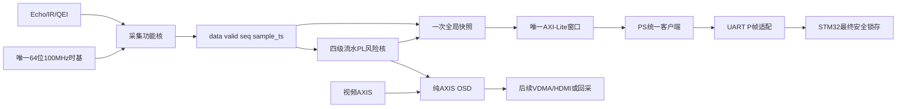

# FPGA项目主架构 v0.6

日期：2026-09-18  
状态：主线骨架、自动验证与可打开Vivado工程已建立；板级和完整视频链路待夜间任务继续。

## 主线

安全主线是采集发布、PL风险、PS协议适配、STM32最终锁存。视频只读风险状态，背压不能阻塞安全数据面。STM32原有200/250mm回差、200ms数据年龄、250ms租约、300ms显式解锁和USB释放规则不因PL风险核而放宽。

## 已落盘的边界

| 层 | 权威入口 | 已冻结内容 | 夜间可继续的范围 |
|---|---|---|---|
| 寄存器 | `fpga/registers/register_map.json` | ID v06、分区、访问属性 | 只能改机器源并重新生成/验收 |
| 感知 | `car_sensors_core.v`、`car_qei_core.v` | 无AXI、无私有时基、发布四元组 | 修复反例、补诊断，不复制包装层 |
| 风险 | `car_risk_core.v` | 四级流水、保守停止距离、原因位、失效即停 | 标定模型与跨层闭环，不能放宽安全语义 |
| 集成 | `car_perception_top.v` | 单时基、单AXI、全局快照 | 补系统测试与PS/BD，不拆成多个地址窗 |
| OSD | `car_axis_osd.v` | AXIS背压、SOF提交、边框/状态块 | 增加数字字模和像素参考，不加帧缓存 |
| 主机 | `host/perception_client.py` | 版本门控、epoch快照、32位回绕 | 接PYNQ MMIO和回放，再接UART适配 |
| 板级 | `fpga/board/board_manifest.json` | 未核实项默认阻塞release | 依据官方XDC/原理图逐项填证据 |

## 速度与时序决策

风险公式的乘法、定点倒数和策略比较分级流水，源数据、时间和序号随结果同行。夜间D修正IR变化时间误作周期年龄后，风险核100MHz OOC WNS为+3.217ns；统一顶层为+2.367ns；夜间B数字OSD为+0.981ns。这只是模块综合估计，不包含PS、I/O、CDC或布局布线。新增算术必须先跑定向TB，再跑统一顶层综合，禁止把长组合除法放回安全路径。

主机只消费全局快照。读取顺序固定为读取旧epoch、写CTRL触发、观察新epoch、读取整组、复核epoch。版本不匹配、快照不稳定或valid/age失败时保持停车。寄存器常量不再手抄。

## Vivado工程和板级门槛

可打开工程：`fpga/build/car_architecture_v0_6/car_architecture_v0_6.xpr`；重建脚本：`fpga/scripts/create_architecture_project.tcl`。该工程只表示PL RTL架构可解析，未包含Zynq PS Block Design、DDR、VDMA、HDMI、完整XDC、bit或hwh。

板级manifest在普通模式只检查结构、重复逻辑端口和重复管脚；`--release`还要求每个管脚、IOSTANDARD、官方来源、原理图版本和电气审查都有证据。当前release预期失败，夜间E完成证据前不能解除。

## 给夜间A—E的修改规则

1. A扩展闭环和风险证据，保留现有四级流水与原因位；发现问题做最小修复。
2. B扩展现有OSD为数字字模和真实仿真PNG，保留AXIS握手与SOF提交。
3. C围绕现有统一顶层和真实xpr做整合，禁止重建第二套顶层或寄存器表。
4. D把现有主机客户端接MMIO、回放和UART闭环，版本/epoch/年龄任一失败保持STOP。
5. E从manifest出发完成板级约束与无电机上板清单；未核实项继续阻塞bitstream release。

统一验收入口为`fpga/scripts/run_acceptance.ps1`。结果必须分软件/RTL、OOC综合、实现、实物四层陈述。
