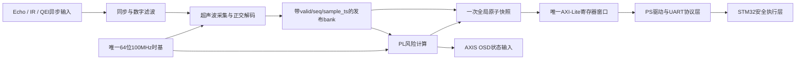

# 任务1—4架构优化 v0.5

日期：2026-09-18  
状态：软件与模块RTL回归通过；未上板；统一生产顶层待夜间C完成。

## 优化结论

任务1—4保留为四个可独立验收的能力层，最终工程不再直接拼接三个带AXI和计数器的验证顶层。生产架构只允许一个64位公共时基、一个AXI4-Lite从机、一个地址译码和一次跨传感器全局快照；`car_axil_regs`、`car_sensors_top`、`car_qei_top`继续作为模块回归包装层。

## 四项职责边界

| 已完成任务 | 保留职责 | 不再承担 |
|---|---|---|
| 任务1 通信与安全闭环 | `$P`帧、请求/样本分离、租约、STM32锁存与解锁规则 | 不用主机心跳刷新传感器年龄，不在Python复制安全状态机 |
| 任务2 AXI与快照基础 | AXI握手、WSTRB、64位时间锁存、committed→shadow原子快照 | 不作为最终独立地址窗口，不读取未提交live总线 |
| 任务3 传感器采集 | 超声波、双红外、故障与真实采样时间 | 不做电机停车决策，不用IR变化刷新距离年龄 |
| 任务4 QEI与测速 | 双路正交解码、周期法速度、诊断与同批影子 | 不假设电机轴PPR等于轮轴CPR，不在PS实时算速度 |

## 本次已实施的结构修复

1. `car_snapshot`增加内部committed bank。只有`live_update`能发布新四元组；trigger不再直接采可能变化中的live总线。同拍提交与触发时新批优先。
2. 公共快照和超声波寄存器拆分完整32位时间与metadata。旧`{valid, ts[30:0]}`约21.47秒回绕，已改为`SNAP_TS/US_SAMPLE_TS`和独立`SNAP_META/US_META`。
3. 超声波复位参数改为60ms空闲、30ms单段超时；最坏故障发布约120ms，为200ms控制过期留下余量。Trig宽度和Echo超时在每轮开始锁存，测量中改配置不影响当前轮。
4. QEI零速窗口由200ms改为100ms。普通64拍除法期间保留上一完整速度批；若输入超过吞吐，则累计overrun、撤销旧valid并从最新周期重启，避免无诊断地短暂失效或丢边。
5. 验证顶层ID采用`0xC425tt05`：`tt`为模块类型、`05`为契约版本，避免不同模块返回同一ID。接口解释集中在`interface_contract.md`，今晚代码不得再按v0.4地址读取。

## 后续统一顶层的硬约束

- 统一顶层建议命名`car_perception_top`，只实例化功能核；不得实例化三个现有验证顶层。
- 一个时钟域即可完成首版时，不增加CDC。异步物理输入只在采集核入口同步；视频若不同域，采用标准AXIS异步FIFO并单独验证。
- 全局快照一次锁存US、IR、QEI0、QEI1、风险结果及各自`valid/seq/sample_ts`；不能拿全局快照时间替换真实采样时间。
- 地址按功能块分区：`0x000—0x03F`公共控制与时间，`0x040—0x07F`传感器，`0x080—0x0BF`QEI，`0x0C0—0x0FF`风险，`0x100`以后配置。生成一份机器可读寄存器表供RTL、Python与文档共同使用，避免三处手抄漂移。
- 风险RTL只消费已发布批次，并用无符号32位差分检查年龄；配置非法、valid=0、overrun或年龄到界均输出禁止运动原因。STM32继续保留最终独立锁存。
- OSD只消费影子状态或帧边界提交的参数，不反向参与安全判定。视频背压不得阻塞感知、风险或UART。

## 更快的开发与验收方式

- 模块开发仍运行对应XSim；接口或算术变化后再运行完整`run_acceptance.ps1`，避免每次小改都重综合全部模块。
- 总回归加入统一顶层端到端TB；一套输入同时核对寄存器快照、风险原因和送往Python的值，减少重复测试模型。
- 从寄存器描述生成Verilog常量、Python常量和Markdown表，人工只维护一个源文件。
- 综合分两级：每次接口变更做统一顶层OOC综合；到XDC和Block Design稳定后再做完整实现。报告必须区分OOC、实现和上板。
- 失败保存首个反例和种子，修复后先重跑该反例，再跑受影响模块，最后跑全量；不靠增加随机次数替代定位。

## 当前证据边界

本次定向新增验证覆盖未提交live隔离、32位时间最高位保留、测量中配置不可变、测速计算期valid保持和除法overrun恢复。统一生产顶层、板级XDC、PS/DDR/VDMA/HDMI以及实物电平仍未验证，后续任务不得把模块PASS写成整机PASS。
